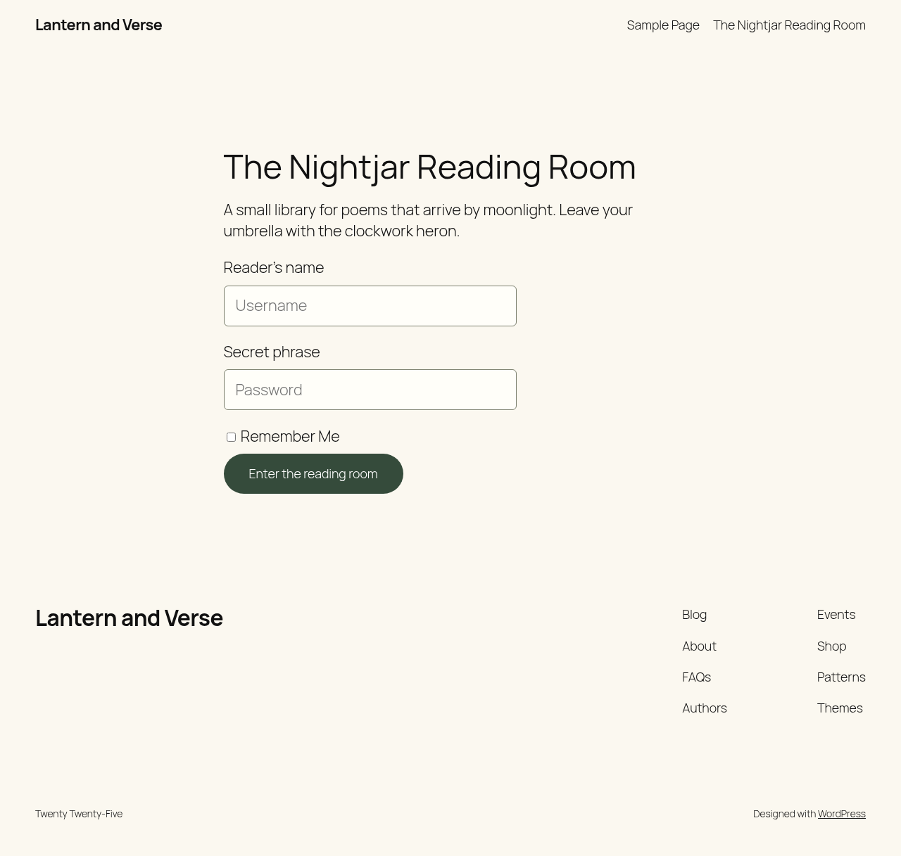

<!-- ACE_SUITE_BRAND:START -->
<p align="center">
  <a href="https://acemedia.ninja/"></a>
</p>

<p align="center">
  <a href="https://acemedia.ninja/">Ace Media</a> · <a href="https://acemedia.host/">WordPress hosting</a>
</p>
<!-- ACE_SUITE_BRAND:END -->

# Ace Login Block

**Contributors:** Shane Rounce of AceMedia.ninja
**Tags:** login, block, custom login, WordPress, Gutenberg, security
**Requires at least:** 6.6
**Tested up to:** 7.1
**Requires PHP:** 8.2
**Version:** 0.430.0
**License:** GPLv2 or later
**License URI:** https://www.gnu.org/licenses/gpl-2.0.html

Customise your WordPress login page with a fully-integrated Gutenberg block, giving you complete control over the design and functionality.

## Requirements and recovery

PHP 8.2 or later. Passkeys also need PHP's OpenSSL extension. If it is missing, passkeys switch themselves off and everything else, including email codes, authenticator apps, backup codes and login lockout, keeps working. An account that needs a passkey for its second factor is refused with a clear message, so the policy is never quietly dropped.

If PHP is older than 8.2 or the bundled libraries cannot load, the plugin blocks new logins rather than silently dropping second-factor protection. Restore the supported runtime and the complete package through your hosting account. Public pages and existing sessions are not intentionally blocked.

I have tested it on WordPress 6.6, 6.9 and 7.1. The details are in [docs/release-validation.md](docs/release-validation.md). They do not cover every browser, authenticator or plugin combination, so please tell me about anything that misbehaves.

## Description

Ace Login Block allows you to replace the default WordPress login page with a custom page of your choosing, all designed and managed within the block editor. This lets you create a branded login experience for your users while leveraging the flexibility and ease of Gutenberg.

### Features include:
- Replace the default WordPress login page with a custom block-based design.
- Full integration with the block editor, giving you complete control over the login page layout.
- Allow the default WordPress login functionality for POST requests to ensure smooth login submissions.
- Customise redirects and add additional fields or branding elements to the login page.
- Prevent further execution of the default `wp-login.php` after your custom login template loads.
- Role-based redirects and per-role 2FA requirements.
- Passkeys (security keys) for passwordless login and as a second factor.
- Email and authenticator app 2FA, plus backup codes.
- Remembered devices that skip 2FA only (password still required).
- Login lockout after repeated failed attempts.
- Passkey policy settings: RP ID override, attestation preference, and per-role passwordless control.

Ace Login Block provides a seamless way to craft unique, branded login experiences while ensuring compatibility with WordPress’s login handling.

## Source Code

The source code for this plugin, including uncompressed JavaScript and CSS files, is available on GitHub. You can find it here:

**GitHub Repository:** [Ace Login Block on GitHub](https://github.com/AceMedia/WordPress-Login-Block-and-Page)

We use npm and webpack to compile assets for production. Public issues and feature requests are welcome. Ace Media invites contributors to the upstream project; please discuss proposed changes before submitting a pull request. This contribution policy does not restrict your GPL rights to use, study, modify or redistribute the code.

## Installation

This section describes how to install the plugin and get it working.

1. Upload the plugin files to the `/wp-content/plugins/acemedia-login-block` directory, or install the plugin through the WordPress plugin screen directly.
2. Activate the plugin through the 'Plugins' screen in WordPress.
3. Navigate to the "Ace Login Block" settings and select the page to use for your custom login page.

## Frequently Asked Questions

### How do I customise my login page?

Once the plugin is activated, go to the "Ace Login Block" settings in your WordPress dashboard and select the page you want to use as your custom login page. You can then use the block editor to design the page.

### Will WordPress still handle logins?

Yes, WordPress will continue to handle all login submissions via POST requests, ensuring that authentication continues to work normally. Ace Login Block simply replaces the display of the login page with your custom page design for GET requests.

### Can I add custom fields to my login page?

Yes, you can add custom blocks, text, images, or any other elements within the block editor to fully customise the layout of your login page.

### What happens if I disable the plugin?

If you disable Ace Login Block, WordPress will revert to the default `wp-login.php` page for login access.

### Do remembered devices bypass my password?

No. Remembered devices only skip the 2FA step. Password entry is still required.

### Do passkeys require HTTPS?

Yes. Passkeys require a secure context (HTTPS or `http://localhost`).

## Screenshots

The Nightjar Reading Room is a fictional demonstration, using Twenty Twenty-Five and a small amount of demo theme CSS. No client material or real account data is shown.



[View the mobile example](docs/screenshots/nightjar-mobile.png). These images can be prepared as WordPress.org `assets/screenshot-1.png` and `assets/screenshot-2.png` when the release is approved; they are not bundled in the installable ZIP.

## Changelog

### 0.427.0
**Release Date:** 2026-02-24
- Fixed inconsistent 2FA form state handling that could show false authentication popups during successful login.
- Replaced disruptive login alerts with inline status messages across custom login and wp-login flows.
- Improved browser compatibility and secure-context messaging for passkeys.
- Added admin guidance for security key setup, including Flipper Zero/FIDO2 usage notes.
- Improved passkey registration feedback and request handling reliability in user profile screens.

### 0.426.0
**Release Date:** 2024-12-05
- Fixed the selector for the form submission button.

### 0.425.0
**Release Date:** 2024-11-11
- Allows users to be redirected based on role-specific settings, even if no custom login page is set.

### 0.424.0
**Release Date:** 2024-11-11
- Ensures login block functionality is only active when a custom login page override is set.
- Prevents interference with the default WordPress login process when no override page is configured.

### 0.423
**Release Date:** 2024-10-12
- New Feature: Implemented dynamic login redirects based on user roles, allowing specific redirect URLs for each role within the settings.
- Enhancement: Updated `ace-login-block.php` to handle dynamic redirects, ensuring users are sent to the appropriate page after logging in based on their role.
- Enhancement: Modified `package-lock.json` and `package.json` to include new dependencies required for the updated functionality.
- Enhancement: Enhanced `src/block.json` to support role-based page listings, making it easier to manage page options for each role.
- Enhancement: Updated `src/login-block.js` to dynamically list available pages per role, improving the settings interface for selecting redirect URLs.
- **Important Note:** Ensure that roles are properly configured in the WordPress admin to utilize the dynamic redirect feature effectively.

### 0.422
**Release Date:** 2024-10-12
- New Feature: Introduced a custom login block structure to fully control the layout of the form using native block interactions.
- New Feature: Added new blocks for the username and password input fields.
- Enhancement: Dynamic form action URL is now set using localized data from PHP.
- Enhancement: Added nonce handling to the login form for improved security.
- Enhancement: Improved reliability of redirect handling after login.
- Bug Fix: Resolved an issue with form submission not being detected as a POST request.
- Bug Fix: Fixed redirection issues caused by interception from the custom page template.
- Bug Fix: Improved logout handling to ensure users are correctly redirected after logging out.
- **Important Note:** Ensure the logout link includes the correct `action=logout` parameter and nonce.

### 0.421
**Release Date:** 2024-10-11
- Bug Fix: Resolved issues with form redirection that affected login functionality in v0.420.
- Enhancement: Added a new option to allow users to show the "Show Password" toggle in the login block.

### 0.420 (Pre-Release)
**Release Date:** 2024-10-11
- Initial Release: First release of the Ace Login Block plugin.
- Key Features:
  - Custom Login Page: Replace the default `wp-login.php` form with a page created in the block editor.
  - Post Request Handling: Securely handles login form submissions.
  - Seamless Template Loading: Automatically loads the selected custom page template.
  - Block Editor Integration: Customise your login page using blocks.
  - Debugging: Debug messages included to assist with development.
- **Important Note:** Known issues with form redirection in this version, recommended to use v0.421 for better performance.

## Advanced Use

Ace Login Block is perfect for developers and site owners looking to create unique, branded login experiences. By leveraging the block editor, you can design your login page however you see fit, from adding custom fields to embedding brand logos or messages. The plugin ensures that login functionality remains intact while offering flexibility over the appearance and content of the login page.


## Development Setup

To set up a development environment for the plugin, ensure that you have [Node.js](https://nodejs.org) installed and then run the following commands:

```bash
# Install production PHP dependencies from the committed lockfile
composer install --no-dev --prefer-dist --no-interaction

# Install build dependencies
npm ci

# Build the plugin for production
npm run build

# Watch for file changes in development
npm start

# Run linter to check for code issues
npm run lint:js

# Format code automatically
npm run format

# Create a zip file for deployment
npm run plugin-zip
```

## Release packaging

Run `npm run build` before `npm run plugin-zip`. Python 3 builds `dist/acemedia-login-block-0.429.0.zip` with the WordPress.org slug as its top-level directory, plus a SHA-256 manifest. Only the plugin entry point, `readme.txt`, `LICENSE`, `composer.json`, `includes`, `build` and the locked production `vendor` packages are staged. Source, build configuration, tests and dependency lockfiles remain on GitHub so builds can be inspected and reproduced.

Never publish a candidate until the release matrix and security review are complete. The manifest checks package composition, not secrets or runtime compatibility. Full source and Git-history secret scanning is a separate release gate.

Part of the Ace plugin suite, maintained by [Ace Media](https://acemedia.ninja/). Explore [Ace Media Host](https://acemedia.host/) for hosting information.

See [candidate validation evidence](docs/release-validation.md) for executed checks and remaining release gates.
